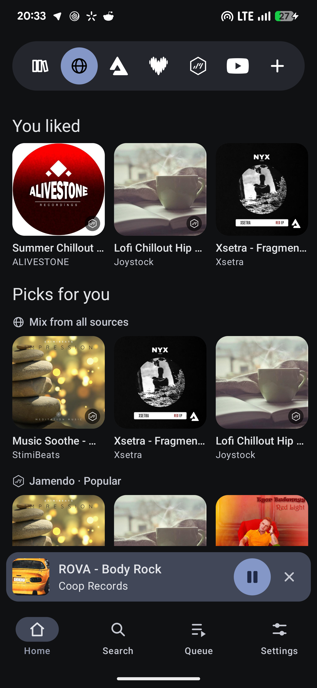
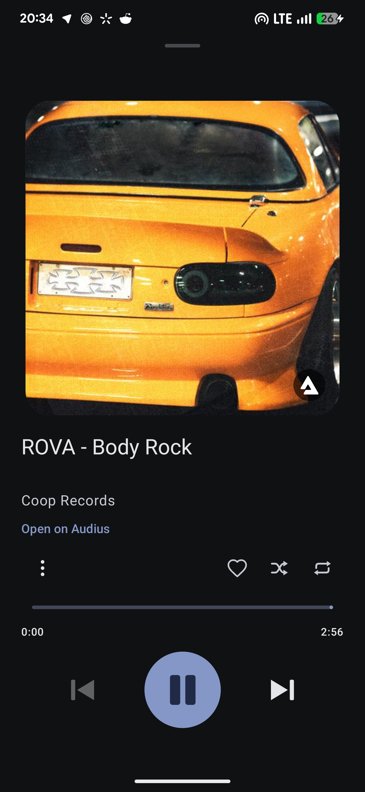
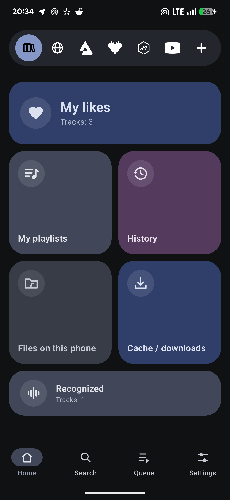
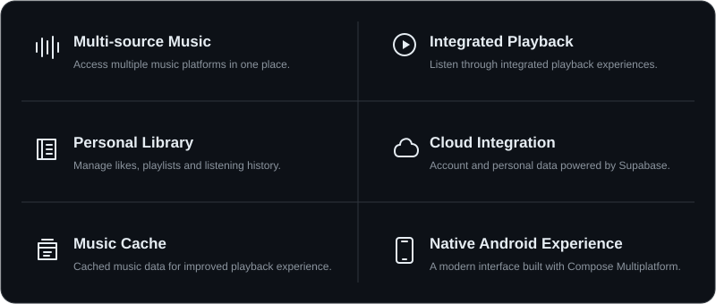

<!-- ==================== HEADER ==================== -->

<table>
  <tr>
    <td width="180" align="center" valign="middle">
      
    </td>
    <td valign="middle">
      <h1>SOLARA</h1>
      <h3>Your music. Your space.</h3>
      

        A unified music experience built with Kotlin Multiplatform,
        designed for Android.
      

    </td>
  </tr>
  <tr>
    <td colspan="2" align="center">
      
      
      
      
    </td>
  </tr>
</table>

---

<!-- ==================== NAVIGATION ==================== -->

## Navigation

  <a href="#about-solara">About</a> &nbsp;·&nbsp;
  <a href="#features">Features</a> &nbsp;·&nbsp;
  <a href="#screenshots">Screenshots</a> &nbsp;·&nbsp;
  <a href="#music-providers">Providers</a> &nbsp;·&nbsp;
  <a href="#tech-stack">Tech Stack</a> &nbsp;·&nbsp;
  <a href="#architecture">Architecture</a> &nbsp;·&nbsp;
  <a href="#installation">Installation</a> &nbsp;·&nbsp;
  <a href="#roadmap">Roadmap</a> &nbsp;·&nbsp;
  <a href="#license">License</a>

---

<!-- ==================== ABOUT SOLARA ==================== -->

## About Solara

  
  
  

  <strong>Solara</strong> is a music application built with Kotlin Multiplatform and Compose Multiplatform, designed to bring multiple music streaming services together in a unified Android experience.

  It combines music playback, discovery, and personal library management within a single application.

  Built around the idea of a connected music experience, Solara aims to simplify how users discover, access, and organize their music — bringing different sources together in one personal space.

---

<!-- ==================== FEATURES ==================== -->

## Features

  

### Music & Playback
- Access music from multiple streaming providers in one application.
- Unified playback experience.
- Dedicated player interface and playback controls.
- Track discovery and search across supported providers.

### Personal Library
- Save and manage liked tracks.
- Create and manage playlists.
- Keep track of listening history.
- Discover music through recommendations.

### Account & Personalization
- User authentication.
- Personal profiles with avatar support.
- Cloud-backed user data.
- Material 3 interface and theming.
- English and Ukrainian interface languages.

---

<!-- ==================== SCREENSHOTS ==================== -->

## Screenshots

  
  
  
  

---

<!-- ==================== MUSIC PROVIDERS ==================== -->

<h2 align="center">Music Providers</h2>

  Solara integrates several music services, each with its own playback capabilities and limitations.

<table align="center">
  <tr>
    <td width="50%" align="center" valign="middle">
      <h3>Jamendo</h3>
      
Full-track streaming

      Search and play full tracks directly inside Solara.
    </td>
    <td width="50%" align="center" valign="middle">
      <h3>Audius</h3>
      
Full-track streaming

      Discover and play available tracks directly inside Solara.
    </td>
  </tr>
  <tr>
    <td width="50%" align="center" valign="middle">
      <h3>Deezer</h3>
      
Music discovery

      Search and listen to 30-second previews through the public API.
    </td>
    <td width="50%" align="center" valign="middle">
      <h3>YouTube</h3>
      
Video-based playback

      Search and play music using the embedded YouTube player.
    </td>
  </tr>
  <tr>
    <td colspan="2" align="center" valign="middle">
      <h3>Spotify</h3>
      
Remote playback control · Android · Premium

      Control the Spotify application through the official Spotify App Remote SDK.
    </td>
  </tr>
</table>

  <strong>Playback limitations</strong>

  Deezer provides 30-second previews through its public API. 
  YouTube playback requires the embedded player to remain visible. Background playback is not supported. 
  Spotify integration requires Spotify Premium and the Spotify application. Solara does not store Spotify music or account data.

<!-- ==================== TECH STACK ==================== -->

## Tech Stack

<table align="center">
  <tr>
    <td align="center" width="12.5%">
        
      <strong>Kotlin</strong> 
      Programming Language
    </td>
    <td align="center" width="12.5%">
        
      <strong>Compose</strong> 
      UI Framework
    </td>
    <td align="center" width="12.5%">
        
      <strong>Ktor</strong> 
      HTTP Client
    </td>
    <td align="center" width="12.5%">
        
      <strong>Coroutines</strong> 
      Async & Flow
    </td>
    <td align="center" width="12.5%">
        
      <strong>Supabase</strong> 
      Cloud Services
    </td>
    <td align="center" width="12.5%">
        
      <strong>Media3</strong> 
      Audio Playback
    </td>
    <td align="center" width="12.5%">
        
      <strong>Gradle</strong> 
      Build System
    </td>
    <td align="center" width="12.5%">
        
      <strong>Android</strong> 
      Target Platform
    </td>
  </tr>
</table>

---

<!-- ==================== ARCHITECTURE ==================== -->

## Architecture

Solara is built with a modular Kotlin Multiplatform architecture, using shared application logic and platform-specific playback integrations.

### Project Modules

| Module | Responsibility |
|---|---|
| `shared` | Shared application logic, UI, data and provider integrations |
| `androidApp` | Android application entry point and platform-specific functionality |

### Core Technologies

- **Compose Multiplatform** — declarative UI.
- **Kotlin Coroutines & Flow** — asynchronous operations and reactive data streams.
- **Ktor** — HTTP communication with external services.
- **Kotlinx Serialization** — data serialization.
- **Supabase** — authentication, database and storage services.
- **Android Media3** — Android audio playback.
- **Spotify App Remote SDK** — remote Spotify playback control.

### Provider Integration

Each music provider has its own integration and playback behavior. This keeps provider-specific API logic separate from the common application experience.

---

<!-- ==================== INSTALLATION ==================== -->

## Installation

To install Solara on your Android device:

1. Open the [Releases](https://github.com/unknowstorm/solara_project/releases) page.
2. Download the APK file from the latest release.
3. Open the downloaded APK on your Android device.
4. If required, allow installation from unknown sources.
5. Complete the installation and launch Solara.

---

<!-- ==================== ROADMAP ==================== -->

## Roadmap

Solara is an evolving project. The following areas represent potential future improvements.

- [ ] Improve and expand music provider integrations.
- [ ] Refine the unified playback experience.
- [ ] Improve library and playlist management.
- [ ] Expand personalization and discovery features.
- [ ] Continue UI and UX improvements.
- [ ] Improve application stability and performance.

---

<!-- ==================== LICENSE ==================== -->

## License

Solara is licensed under the [MIT License](LICENSE).

Third-party services, SDKs and trademarks belong to their respective owners. Use of their APIs and integrations must comply with their terms and developer policies.

---

  <strong>SOLARA</strong> 
  Your music. Your space.

